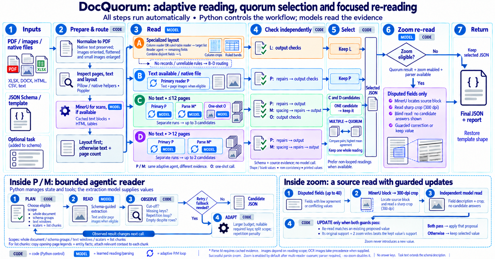

# DocQuorum pipeline guide

Current implementation: [v1.4 specification](DESIGN.md). The [main figure review](fig/docquorum-pipeline-imagegen-v6.md) records its source basis and simplifications.

Start with [the illustrated document](docquorum.pdf): task definition, complete data flow, exact reader behavior, checks, candidate selection, and a synthetic walkthrough.

- [LaTeX source](docquorum.tex)
- [Main pipeline diagram (PNG)](fig/docquorum-pipeline-imagegen-v6.png), [standalone PDF](fig/docquorum-pipeline-imagegen-v6.pdf), and [generation prompts](fig/docquorum-pipeline-imagegen-v6-prompt.txt)
- [Alternative vector diagram (PDF)](fig/pipeline.pdf) and [editable TikZ source](fig/pipeline.tex)
- [Shared evidence and separate candidate flows](fig/evidence-sharing.tex)
- [Complete schema / answer JSON examples and attribution](examples/README.md)
- [Results tables: sources and snapshots](results/README.md)
- [Illustrated purchase-order trace](fig/scan-trace.tex) and [four routing examples](fig/route-examples.tex)
- [Controller, reader agents and tools: exact roles](AGENTS_AND_TOOLS.md)
- [Implementation map](CODE_GUIDE.md)



The overview separates automatic execution from bounded adaptive reading: the general reader observes model results and retries or changes scope; Python controls the loop. Routing, checks and quorum are deterministic.

The landscape overview on page 2 follows the flow from left to right: route, read, check, select, zoom when eligible, return. Page 3 distinguishes MinerU's shared evidence from the separate candidate JSONs. Pages 4--5 explain the conversion ratio and the fallback plans inside a reading. Page 6 pairs a synthetic purchase-order schema with its complete answer. Landscape page 7 shows an actual DocuBench electricity-bill schema and the full published reference answer, with source facts and attribution. Page 11 follows the purchase order through three candidates. Page 12 compares document routes; page 13 explains the ExtractBench and UNIKIE runners. The main diagram describes the current v1.3 single-document API. The detailed worked examples and earlier explanatory pages retain their original `b4ea9a1` provenance; use `DESIGN.md` for the current exact rules. Synthetic examples are marked; the public reference answer is demonstration material, not a new extraction result.

## Build

With `pdflatex`, TikZ/PGF, Latin Modern, and the standard LaTeX packages installed:

```sh
make -C docs
make -C docs preview  # optional PNG refresh; requires Poppler's pdftoppm
make -C docs clean
```

Run from the repository root. If Poppler is outside your `PATH`, set `PDFTOPPM=/path/to/pdftoppm` when running the preview target. The revised main figure is an image-model-generated raster asset; its standalone PDF embeds the same PNG without adding resolution. The alternative TikZ figure remains editable vector artwork, and `preview` refreshes that alternative's PNG. The build uses the saved assets and makes no model calls, dataset requests, or network downloads.

The results section has one table per benchmark, pages 14-19: ExtractBench (all 47 published systems; DocQuorum 3rd with Overall 95.43), UNIKIE-BENCH (15 systems; DocQuorum 1st at 82.65), VAREX (20 models; 1st at 98.30), UNIKIE-BENCH open category (15 systems; 2nd at 72.33), LongArray-Extract (11 systems; 2nd at 98.05) and DocuBench (9 systems; 5th). Each has one DocQuorum row, placed by score; the tables are generated from `results/` (`docs/results/generate_tables.py`).

Benchmark predictions and evaluation outputs remain in the repository's `results/`; the snapshots used in this guide are in `docs/results/`. Older documentation is available in Git history.
