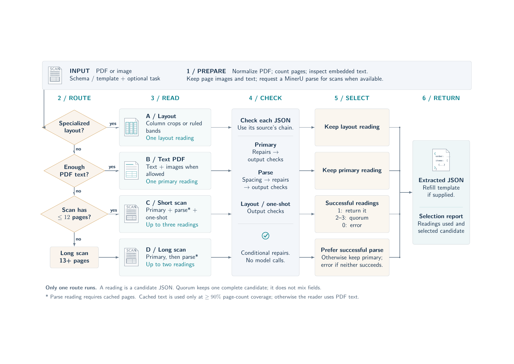

# DocQuorum pipeline guide

Start with [the document](docquorum.pdf): task definition, complete data flow, exact reader behavior, checks, candidate selection, and a synthetic walkthrough.

- [LaTeX source](docquorum.tex)
- [Main pipeline diagram (PDF)](fig/pipeline.pdf) and [editable TikZ source](fig/pipeline.tex)
- [Shared evidence and separate candidate flows](fig/evidence-sharing.tex)
- [Complete schema / answer JSON examples and attribution](examples/README.md)
- [Illustrated purchase-order trace](fig/scan-trace.tex) and [four routing examples](fig/route-examples.tex)
- [Implementation map](CODE_GUIDE.md)



The landscape overview on page 2 follows the flow from left to right: route, read, check, select, return. Page 3 distinguishes MinerU's shared evidence from the separate candidate JSONs. Pages 4--5 explain the conversion ratio and the fallback plans inside a reading. Page 6 pairs a synthetic purchase-order schema with its complete answer. Landscape page 7 shows an actual DocuBench electricity-bill schema and the full published reference answer, with source facts and attribution. Page 11 follows the purchase order through three candidates. Page 12 compares document routes; page 13 explains the ExtractBench and UNIKIE runners. The main diagram describes the single-document API, based on source revision `b4ea9a1`. Synthetic examples are marked; the public reference answer is demonstration material, not a new extraction result.

## Build

With `pdflatex`, TikZ/PGF, Latin Modern, and the standard LaTeX packages installed:

```sh
make -C docs
make -C docs preview  # optional PNG refresh; requires Poppler's pdftoppm
make -C docs clean
```

Run from the repository root. If Poppler is outside your `PATH`, set `PDFTOPPM=/path/to/pdftoppm` when running the preview target. Both PDFs and the PNG preview are committed so reading the guide does not require LaTeX. The diagram is vector artwork and shares its source with the document. There are no model calls, dataset dependencies, or network downloads in the build.

This folder replaces the former write-up and benchmark-example bundle. Benchmark outputs and results remain in `results/`; older documentation is available in Git history.
