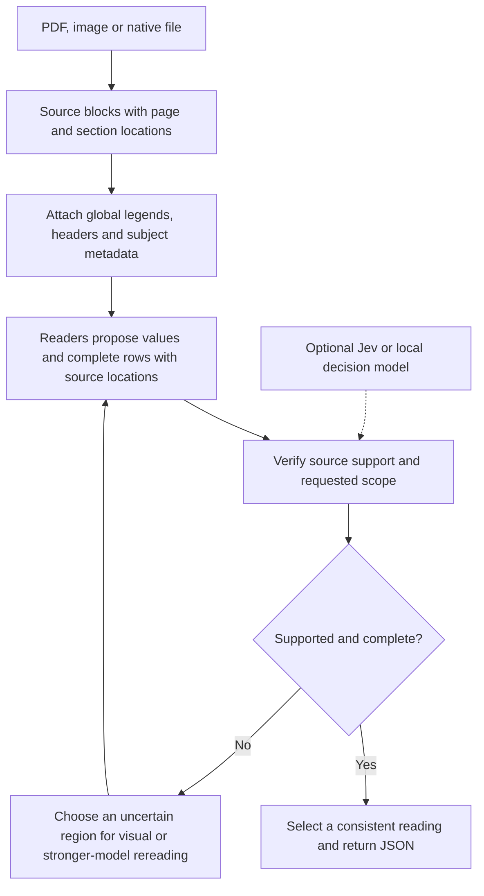

# Jev and the next DocQuorum experiment

Assuming “JEv” means TypeSafe AI's **Jev**, it is a model for typed decisions:
**Choice** selects a supplied option, **Score** rates against ordered criteria,
and **Noul** estimates the probability of a proposition. It accepts text/JSON,
not document images. These are current vendor interface descriptions, not our
measured extraction results. [Primitives](https://docs.typesafe.ai/primitives);
[input state](https://docs.typesafe.ai/concepts/state).

The proposed role is source verification and routing after extraction. For
example, ask whether a candidate event comes from the requested primary listing,
whether the row belongs to the stated subject, and whether the code legend
supports its interpreted value. Keep these questions separate and combine their
answers in code. Jev cannot select a correct value that no reader has proposed;
an unsupported or missing candidate should trigger another source reading.

This diagram is a proposal. The current frozen pipeline uses deterministic
checks and chooses a complete reading; the proposed semantic verifier and
feedback loop have not been implemented or measured.

## Measured priorities

1. **Repair selector inputs and expose scorer errors.** The VAREX adapter omitted
   `pdf`; the agreement helper caught `KeyError` and returned zero on all 1,776
   documents with usable readings. One document had no usable readings. The
   separate repaired selector scores **97.7898%**, versus **96.9503%** for the
   original adapter and **97.6807%** for guided extraction, across all 1,777
   documents and 21,084 fields. It adds 177 net correct fields over the original
   and 23 over guided, retaining failures. The document-cluster bootstrap interval
   for the gain over guided includes zero (−0.0142 to +0.2397 percentage points).
   This is stored-output development work, not fresh inference or an independent
   holdout. No Jev calls were made. [Score](../results/multibench/varex_selector_v2/scores/full/summary.json);
   [paired comparison](../results/multibench/varex_selector_v2/paired_comparison.json).
2. **Preserve scope and context across windows.** The LongArray V4 clinical pilot
   returns 363 rows for 198 expected and scores 59.4545%; it includes zero-event
   blocks excluded by the schema. Attach source-derived legends and subject
   metadata, distinguish primary from supportive listings, and give each physical
   row one source owner. Gold counts must remain unavailable during inference.
3. **Reread selectively after verifying coverage.** Keep a ledger of source
   regions and schema fields visited. Use disagreement, unsupported values and
   incomplete rows to schedule recovery. DocuBench V6 improves the full 72-task
   score from 63.8574 to 74.7936%, but remains 16.9388 points below published third
   place. Completion checks alone are insufficient.

## Experiment and paper claim

Compare best single reader, repaired quorum, a source verifier using the local
model, and the same verifier using Jev. Freeze reader outputs, budgets and
selection policies before held-out evaluation. Include failure rates, array
precision/recall, source coverage, cost and latency; report reference ranks only
on matching complete cohorts. Measure candidate recall separately from selector
accuracy so missing evidence cannot be hidden by confident decisions.

Calibrate thresholds on development documents, keeping templates/source families
out of the holdout. Jev's Choice/Score confidence measures distribution
concentration, not a correctness guarantee. Test candidate order and neutral
option identifiers: a recent preprint finds sensitivity to semantic option names
despite type-valid outputs. [Confidence definition](https://docs.typesafe.ai/confidence);
[option-label study, preprint](https://arxiv.org/abs/2609.26758).

The research hypothesis is that source scope, context propagation and coverage
can guide verification and rereading more reliably than agreement alone. A
general method, controlled ablations and held-out accuracy/cost gains could
support a strong paper. Adding a hosted model or fixing this adapter alone does
not establish novelty, SOTA or acceptance at an A* venue.
